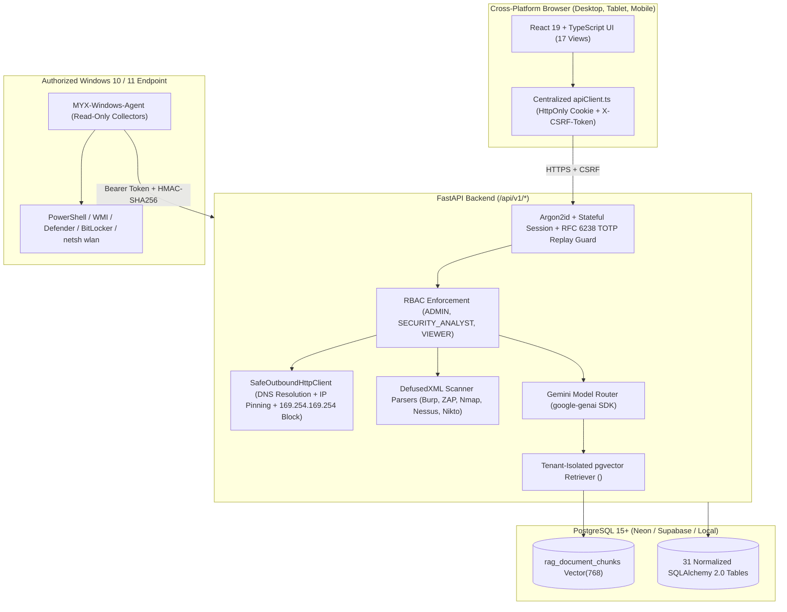

# SYSTEM ARCHITECTURE — MYX AI (WINDOWS EDITION)

**Brand:** MYX AI by Midhun Krishnan ("Discover. Detect. Defend.")

---

## 1. High-Level Architecture Diagram

---

## 2. Outbound SSRF & DNS Rebinding Protection Flow

1. **Scheme Validation:** Only `http://` and `https://` are allowed. `file://`, `gopher://`, `ftp://`, `dict://`, and `ldap://` are immediately rejected.
2. **Allowlist Verification:** Every Website, Network, SSL/TLS, or DNS assessment verifies that the target exists in `authorized_targets` with `verification_status == 'VERIFIED'`.
3. **DNS Resolution & IP Blocklist Validation:** Before opening a socket, `validate_and_resolve_target_url` resolves all `A`/`AAAA` records and checks every IP against:
   - Loopback (`127.0.0.0/8`, `::1/128`, `localhost`) — Unconditionally blocked.
   - Link-Local & Cloud Metadata (`169.254.0.0/16`, `169.254.169.254`, `fe80::/10`) — Unconditionally blocked in all modes.
   - RFC 1918 Private Ranges (`10.0.0.0/8`, `172.16.0.0/12`, `192.168.0.0/16`) — Blocked unless `ALLOW_CONTROLLED_LAB_TARGETS=true` AND an `ADMIN` approved the target.
4. **Manual Redirect Validation:** Follows at most 5 redirects manually, re-running full DNS and IP validation on every `Location` header hop.
